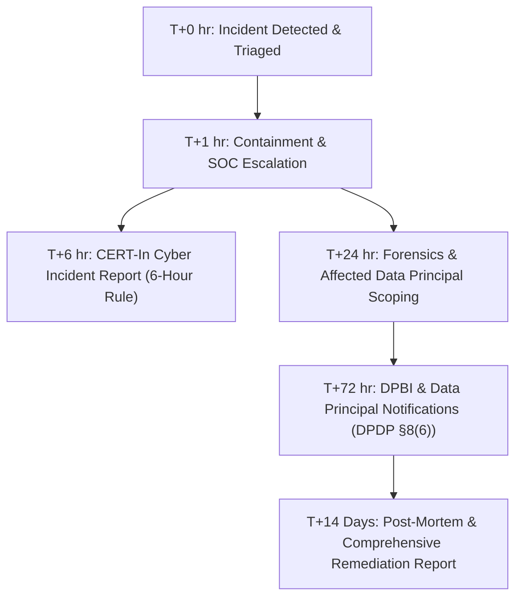

# Personal Data Breach Response Plan & Regulatory Notification Runbook

**Statutory Basis**: 
- Section 8(6) of the Digital Personal Data Protection (DPDP) Act, 2023 (Act No. 22 of 2023)
- Digital Personal Data Protection Rules, 2025 (Breach Reporting Mandates)
- CERT-In Directions under Section 70B of the Information Technology Act, 2000

**Document Version**: 2.4.0  
**Effective Date**: October 30, 2026  
**Applicability**: NexGen AI Technologies Platform, Edge Compute Nodes, Serverless Gateways & Micro-Apps

---

## 1. Incident Response Team & Governance

| Role | Designated Officer | Primary Contact | Responsibilities |
| :--- | :--- | :--- | :--- |
| **Incident Commander & Data Protection Lead** | Amay Vikram Singh (Principal Compliance Officer) | `dpo@nexgen.io` / `+91 124 555 0199` | Overall incident command, regulatory notifications to DPBI, legal compliance. |
| **Security Engineering Lead** | NexGen Security Operations Center (SOC) | `security@nexgen.io` | Technical containment, forensic preservation, vulnerability remediation. |
| **Grievance Redressal Officer (India)** | Resident Grievance Officer | `grievance@nexgen.io` | User communications, grievance handling, statutory Data Principal rights. |
| **Infrastructure Lead** | DevOps & Cluster Operations | `devops@nexgen.io` | Credential revocation, token invalidation, zero-trust perimeter isolation. |

---

## 2. Regulatory Timelines & Workflow



### Timeline Milestones

1. **T+0 to T+1 Hour (Detection & Initial Containment)**:
   - Identify unauthorized access, data exfiltration, or breach of zero-trust perimeter.
   - Quarantine compromised node/container, rotate leaked API tokens and database credentials.
   - Preserve immutable forensic audit trails and SIEM event logs.

2. **T+6 Hours (CERT-In Mandatory Reporting)**:
   - Under CERT-In Directions 2022, cybersecurity incidents (unauthorized access to IT systems, data breaches, identity theft) must be reported to `incident@cert-in.org.in` within **6 hours** of notice.

3. **T+24 Hours (Impact Assessment & Scoping)**:
   - Determine specific personal data categories impacted (e.g., account emails, IP telemetry, hashed credentials).
   - Verify whether minors' data or sensitive personal information was accessed.
   - Prepare Data Principal impact matrix.

4. **T+72 Hours (Mandatory DPBI & User Notifications)**:
   - Under Section 8(6) of India's DPDP Act 2023, the Data Fiduciary **MUST** give the Data Protection Board of India and each affected Data Principal intimation of such personal data breach in such form and manner as prescribed under the DPDP Rules 2025.

5. **T+14 Days (Post-Incident Closure)**:
   - Final forensic root cause analysis (RCA), hardening measures, and board filing closure.

---

## 3. Statutory Notification Message Templates

### Template A: Notice to Data Protection Board of India (DPBI)
*To be submitted electronically via the DPBI portal (`https://dpbi.gov.in`) and emailed to `breach-report@dpbi.gov.in` within 72 hours of confirmation.*

```text
To,
The Secretary / Adjudicating Officer,
Data Protection Board of India (DPBI)
Government of India, New Delhi

Subject: Intimation of Personal Data Breach under Section 8(6) of the DPDP Act, 2023

1. Data Fiduciary Details:
   - Legal Entity: NexGen AI Technologies India Private Limited
   - Corporate Identity / Registration: U72900HR2026PTC098231
   - Registered Address: DLF Cyber City, Phase 2, Gurugram, Haryana - 122002, India
   - Grievance Redressal Officer / DPO: Amay Vikram Singh (dpo@nexgen.io / +91 124 555 0199)

2. Nature & Details of Breach:
   - Incident Reference ID: DPBI-BREACH-[TIMESTAMP]-[HEX]
   - Date & Time of Occurrence: [YYYY-MM-DD HH:MM IST]
   - Date & Time of Discovery: [YYYY-MM-DD HH:MM IST]
   - Point of Failure: [e.g., Compromised service credential / Vulnerability in auxiliary edge endpoint]

3. Personal Data Involved:
   - Number of Affected Data Principals in India: [Approximate Count]
   - Categories of Personal Data: [e.g., Name, Email Address, Anonymized Cluster Telemetry]
   - Sensitive / Children's Data Involved: [YES / NO - Detail if any minors under 18 affected]

4. Likely Impact & Consequences:
   - Potential impact on affected Data Principals: [e.g., Risk of phishing, credential stuffing]

5. Containment & Remediation Actions Executed:
   - [x] All affected credentials and session tokens immediately revoked and rotated.
   - [x] Endpoint patched and isolated behind zero-trust WAF filter.
   - [x] Forensic memory snapshot and audit logs captured and preserved for regulatory inspection.
   - [x] Notifications initiated to affected Data Principals per Section 8(6).

6. Lead Investigator & Point of Contact:
   - Name: Amay Vikram Singh
   - Direct Line: +91 124 555 0199 / Email: dpo@nexgen.io

Submitted on behalf of NexGen AI Technologies India Private Limited.
Date: [CURRENT_DATE]
```

---

### Template B: Notice to Affected Data Principals (Users)
*To be dispatched via email and displayed as an in-app security banner within 72 hours.*

```text
Subject: Important Security Advisory regarding your NexGen AI account

Dear [Data Principal Name / Valued Developer],

We are writing to provide you with a transparent advisory regarding a personal data security incident that may have involved certain information associated with your NexGen AI account, in accordance with Section 8(6) of India's Digital Personal Data Protection (DPDP) Act, 2023.

WHAT HAPPENED:
On [DATE] at [TIME IST], our automated Security Operations Center detected an unauthorized access attempt targeting [SPECIFIC COMPONENT/SERVICE]. Within [X] minutes of discovery, our security team contained the incident, isolated the affected systems, and revoked all associated session tokens.

WHAT INFORMATION WAS INVOLVED:
Our forensic investigation confirmed that the affected records may have included:
- Your registered name and email address
- Technical cluster telemetry (browser type, session duration)
- [NO raw passwords or credit card numbers were exposed; passwords are encrypted with bcrypt and payments are processed via PCI-DSS tokenized gateways].

WHAT WE HAVE DONE:
1. Immediately terminated the unauthorized access and isolated the affected infrastructure.
2. Invalidate and rotate all system API keys and session tokens.
3. Formally notified the Data Protection Board of India (DPBI) and CERT-In.
4. Strengthened our zero-trust perimeter and multi-layer rate limiting.

WHAT YOU SHOULD DO:
1. When you next log in to NexGen AI, you will be prompted to verify your credentials.
2. As a standard best practice, remain alert against unsolicited communications or phishing attempts asking for passwords or verification codes. NexGen engineers will never ask for your password.
3. You may exercise your statutory right under Section 11 of the DPDP Act to inspect your personal data archive by visiting your Dashboard: https://nextai-bay.vercel.app/dashboard

YOUR STATUTORY RIGHTS & GRIEVANCE REDRESSAL:
If you have any questions or require assistance, please contact our resident Grievance Redressal Officer directly:
- Officer: Amay Vikram Singh (Principal Privacy & Compliance Officer)
- Email: grievance@nexgen.io / dpo@nexgen.io
- Dedicated Helpline: +91 124 555 0199 (Mon–Fri 09:30–18:30 IST)
- Statutory SLA: Resolution within 7 working days

Under Section 13(3) of the DPDP Act 2023, you also retain the right to approach the Data Protection Board of India (https://dpbi.gov.in) if your grievance is unresolved.

We sincerely regret any inconvenience and remain committed to safeguarding your personal data.

Sincerely,  
NexGen AI Privacy & Security Response Team
```

---

### Template C: Cyber Security Incident Notification to CERT-In
*To be emailed to `incident@cert-in.org.in` within 6 hours of incident identification.*

```text
To,
Indian Computer Emergency Response Team (CERT-In)
Ministry of Electronics and Information Technology (MeitY), Government of India
Email: incident@cert-in.org.in

Subject: Mandatory Incident Reporting under Section 70B of the IT Act, 2000

1. Reporting Organization: NexGen AI Technologies India Private Limited
2. Contact Person: Amay Vikram Singh (dpo@nexgen.io / +91 124 555 0199)
3. Incident Classification: [Unauthorized access to IT systems / Data Breach / Compromised Credential]
4. Date & Time of Incident: [YYYY-MM-DD HH:MM IST]
5. Affected Systems / IPs / Domains: nextai-bay.vercel.app / edge.nexgen.cloud
6. Description of Incident & Impact: [Summary of unauthorized access attempt and impact on systems]
7. Remedial Actions Taken:
   - Compromised credentials revoked and rotated immediately.
   - Attack vectors blocked at Cloudflare/Vercel edge WAF.
   - System and audit logs preserved for forensic inspection.
8. Status: Contained / Remediated.
```

---

## 4. Post-Breach Verification & Remediation Checklist

- [ ] All session tokens and user authorization cookies invalidated.
- [ ] Root cause identified and hotfix deployed through CI/CD with unit tests.
- [ ] DPBI electronic filing reference number archived in compliance register.
- [ ] CERT-In acknowledgment received and logged.
- [ ] All affected Data Principals notified without delay.
- [ ] Post-incident review conducted within 14 days and submitted to Executive Committee.
